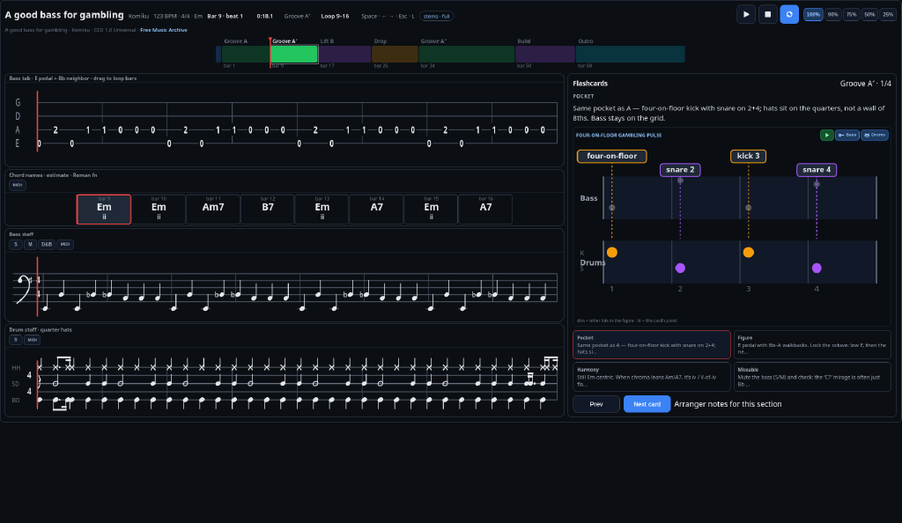

# Song Bass Explainer

A practice player for learning a song and its bass line, and understanding the music theory behind it: what makes this song unique and what makes its bass line work.

The song timeline and sections allow you to see the song at a high level, and selecting a section quickly jumps to it. The main view shows the song chords and their harmonic function, the bass tab and staff, and the drum staff so you can see how the rhythm and harmony are tied together by the bass line. Insight cards highlight parts of that view to make it easier to discover and better understand the song's inner workings. Looping and pitch-preserving tempo control make it easier to learn a difficult line.

## Approach

This was built by talking to Grok Bot, to learn how agent-driven work feels: voice chat, raw screenshot feedback, and rapid-fire instructions. It is not the structured method in [devshop](https://github.com/meirmsn/abra-kadabra). There is no CI and no PR-gated workflow by design; this packaging pull request is an exception so the public page can be reviewed. The loop was barebones: ask, the agent ships, feedback, the next ask. A request queue showed up after rapid-fire instructions piled up. Testing was not assumed at the start; breaks prompted the question of whether tests existed, and the suite grew from there.

## What it does
- Synced bass and drum staves with key and time signatures, and a chord row of playable soft MIDI pads.
- Stem mute and solo, so bass, drums, or both can be heard against the rest of the mix.
- Pitch-preserving tempo at 100%, 90%, 75%, 50%, and 25%, a section timeline that auto-advances, and L to loop the current bar window.
- Insight flashcards (Pocket, Figure, Harmony, Missable) with a two-staff schematic of the claim window. Card Play loops that window; Bass, Drums, and Chords toggles choose what you hear.
- Public demos with no Access gate: Komiku — A good bass for gambling (CC0), HoliznaCC0 — Make Funk (CC0), and Maple Leaf Rag (Public Domain Mark). Private Access holds processed personal tracks.

## How it works
- A Cloudflare Worker (`bass-study`) serves the browser player from `public/` and reads stems and study JSON from R2 (`bass-demo` for public demos, `bass-private` for Access-gated studies). The custom domain is [bass.meirmsn.dev](https://bass.meirmsn.dev).
- Tempo uses a WSOLA time-stretch in the client, so a slower rate keeps the original pitch. Drum notation comes only from processed `drumHits`; an empty list leaves rests.
- Demucs stem splits and study JSON are prepared offline. `scripts/` and `work/` hold pieces of that pipeline. Rebuilding a track still needs the models, a machine that can run them, and the R2 buckets. The Worker does not run Demucs.
- `npm test` runs the vitest suite. `npm run deploy` runs those tests and then Wrangler from a working tree.
- The app was built in conversation with coding agents. There is no CI. The agent kept a long-lived Cloudflare deploy token so this personal tool could ship quickly. For anything shared, add CI on pull requests, replace that long-lived key with short-lived credentials (OIDC, or a deploy a person starts), and run secrets scanning in CI.

## Build log
- 2026-10-25 — first version: player shell and Cloudflare Worker imported; bass MIDI is a soft sine plus a quiet octave layer.
- 2026-10-26 — added public demo tracks: Komiku “A good bass for gambling” (CC0) on `/`, with tempo steps.
- 2026-10-26 — slowing playback was shifting the pitch, and empty drum stems were growing a fake kit → WSOLA time-stretch, and the drum staff shows only that song’s detected hits (no invented kit).
- 2026-10-26 — one demo was a narrow practice set → Make Funk and Maple Leaf Rag joined the public catalog.
- 2026-10-26 — chords and cards were hard to hear and see → playable chord MIDI pads, bass key and time signatures (drums keep time only), two-staff claim-window schematics, and card Play with Bass, Drums, and Chords icons.

## Known limitations
- There is no public YouTube paste-to-process path.
- No CI (by design, see Approach above).

## Run it
- Open the live demo: https://bass.meirmsn.dev
- Local play needs Node, `npm install`, and Wrangler. `npm run dev` (`wrangler dev`) uses the bindings in `wrangler.toml`: `DEMO_BUCKET` → `bass-demo`, `PRIVATE_BUCKET` → `bass-private`, and static assets from `./public`. Those buckets and a Cloudflare API token have to exist; this repo does not include the audio. `npm test` runs vitest with no deploy. `npm run deploy` runs the tests, then `wrangler deploy`, and expects `CLOUDFLARE_API_TOKEN` or `CLOUDFLARE_BUILD_TOKEN`.

## Feedback
Suggestions and critiques welcome — open an issue or a discussion.

## License
MIT
